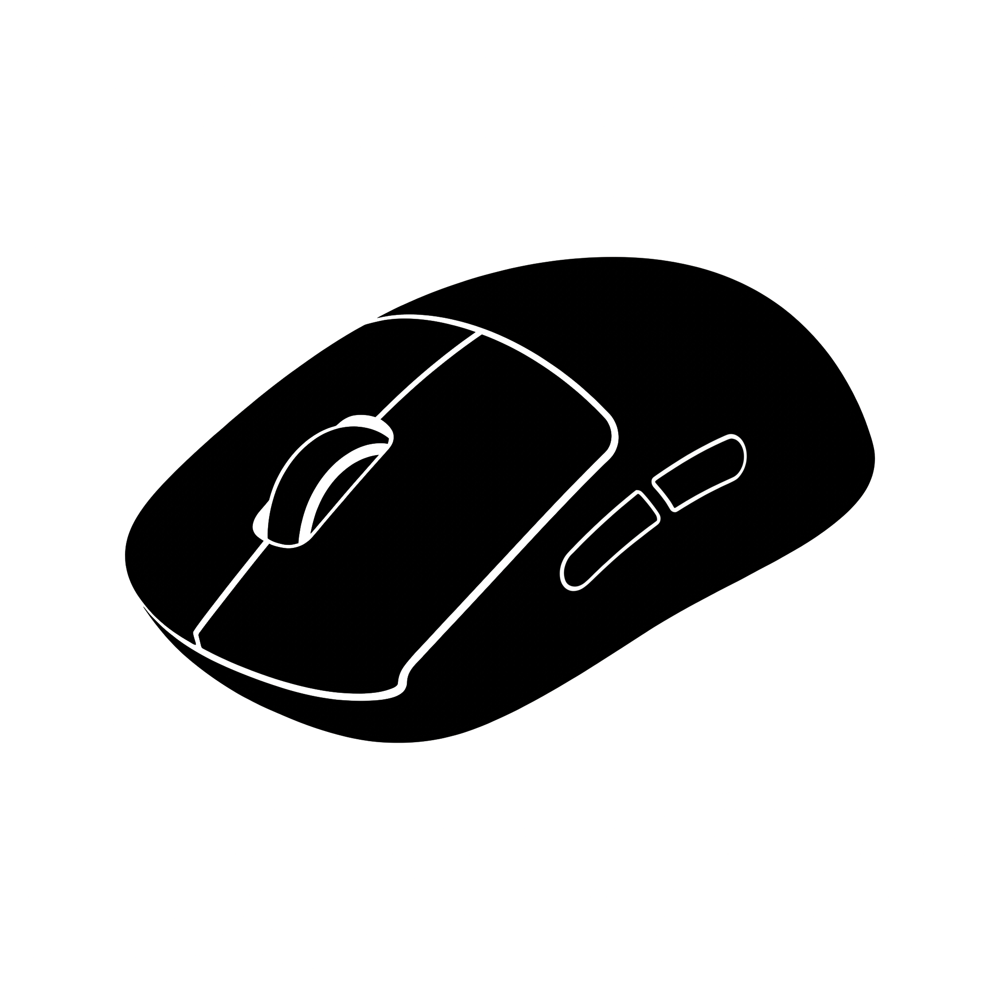

  

  # Mouse Tester
  **Precision Web Hardware Diagnostic Suite**

  
  
  

  

    <a href="#-english"><strong>English</strong></a> •
    <a href="#-português"><strong>Português</strong></a>
  

---

## 🌐 English

**Mouse Tester** is a complete web-based diagnostic suite built to test mouse switches, side buttons, rotary scroll wheel encoders, and optical sensor polling rates (`Hz`). It detects hardware and firmware anomalies in real time and provides technical hypotheses along with step-by-step repair guides after each test session.

### Launch the App
Click the link below to test your mouse directly in your browser (no installation required):
- **[https://carlosmontelima.github.io/mouse-tester/](https://carlosmontelima.github.io/mouse-tester/)**

### Key Features

| Module | What It Tests | Real-Time Anomaly Detection |
| :--- | :--- | :--- |
| **1. Mouse Buttons & Side Switches** | Left (`M1`), Right (`M2`), Middle (`M3`), Side Back (`M4`), and Side Forward (`M5`) | Detects **Double-Click / Switch Chatter** (`< 80ms` interval) and **Hold-Release Dropouts** (`< 45ms` contact loss while holding/dragging). |
| **2. Scroll Wheel & Encoder** | Single-direction locked scroll steps, directional streaks, and live step impulse graph | Locks onto your initial scroll direction to prevent false positives and detects **Reverse Scroll Jumps (Encoder Phase Bounce)** in real time. |
| **3. Polling Rate (`Hz`) & Sensor** | Instantaneous `Hz`, Peak `Hz`, Average `Hz`, Stability `%`, and live waveform | Uses raw uncoalesced pointer streams (`pointerrawupdate` / `getCoalescedEvents`) to flag **USB/Wireless Packet Drops** and **Sensor Jitter Spikes**. |

### Highlights
- **Welcome Screen & Animated Outlines**: Displays the custom mouse icon and title with a progressive glowing purple outline animation and floating ambient particles, transitioning into a top-left header once inside the app.
- **Strictly Isolated Timed Sessions**: Tests never overlap; choose between **30s, 60s, 90s, or 120s** and click **Start Test**.
- **Live Non-Intrusive Notifications**: Smooth top-right glass notifications report anomalies the instant they occur during a test.
- **Post-Test Hypothesis & Fix Guide**: Explains *why* the anomaly happens (e.g., oxidized microswitch leaf springs, dust/grease in the rotary quadrature encoder, or 2.4GHz wireless interference) with an expandable **"What You Can Do to Fix It"** tab.
- **Bilingual (`EN` / `PT-BR`) & Theme Switcher**: Instant language switching between English and Portuguese, plus Dark and Light themes.

---

## 🇧🇷 Português

O **Mouse Tester** é uma suíte completa de diagnóstico via web desenvolvida para testar todos os aspectos do seu mouse: cliques principais, botões laterais, scroll (codificador rotativo) e taxa de atualização (*Polling Rate* em `Hz`). Ele detecta anomalias de hardware e firmware em tempo real e apresenta hipóteses técnicas detalhadas com um guia interativo de como resolver cada problema.

### Acesse o App Online
Clique no link abaixo para testar seu mouse direto no navegador (sem precisar instalar nada):
- **[https://carlosmontelima.github.io/mouse-tester/](https://carlosmontelima.github.io/mouse-tester/)**

### Principais Funcionalidades

| Módulo de Teste | O Que É Testado | Detecção de Anomalias em Tempo Real |
| :--- | :--- | :--- |
| **1. Botões & Switches Laterais** | Botão Esquerdo (`M1`), Direito (`M2`), Meio (`M3`), Lateral Voltar (`M4`) e Avançar (`M5`) | Detecta **Duplo Clique Indesejado / Switch Chatter** (intervalo `< 80ms`) e **Falha ao Segurar / Arrastar** (perda de contato `< 45ms` durante o clique pressionado). |
| **2. Scroll Wheel & Encoder** | Passos travados em direção única, sequência direcional e gráfico de passos ao vivo | Trava na primeira direção rolada para evitar falsos positivos e detecta **Scroll Reverso (Encoder Bounce)** no exato momento em que ocorre. |
| **3. Polling Rate (`Hz`) & Sensor** | Taxa `Hz` ao vivo, Pico `Hz`, Média `Hz`, `%` de Estabilidade e gráfico contínuo | Analisa eventos brutos do ponteiro (`pointerrawupdate` / `getCoalescedEvents`) para identificar **Quedas de Polling (Packet Drops)** e **Picos de Jitter do Sensor**. |

### Destaques do Projeto
- **Tela de Boas-Vindas Animada**: Apresenta o ícone personalizado do mouse e o título com contornos roxos brilhantes desenhados gradualmente e partículas flutuantes, transformando-se em um cabeçalho interativo no canto superior esquerdo ao entrar no app.
- **Testes Isolados com Tempo Configurável**: Os testes nunca rodam juntos para garantir precisão; escolha entre **30s, 60s, 90s ou 120s** e inicie pelo botão **Iniciar Teste**.
- **Notificações em Tempo Real**: Alertas elegantes deslizam no canto superior direito assim que uma anomalia é detectada durante o teste.
- **Hipótese de Diagnóstico & Aba de Soluções**: Ao final do tempo, o app descreve o que está acontecendo fisicamente/eletricamente no mouse e disponibiliza uma aba clicável mostrando passo a passo **o que fazer para consertar**.
- **Bilíngue (`EN` / `PT-BR`) & Tema Escuro/Claro**: Alternância instantânea de idioma (Inglês/Português) e de tema (**Dark Mode** e **Light Mode**).

---

  Desenvolvido por <strong><a href="https://github.com/carlosmontelima">Carlos Monte Lima (@carlosmontelima)</a></strong>

